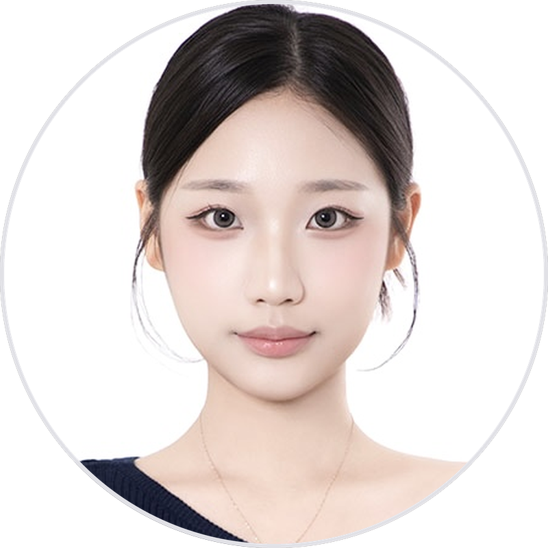

# 이채윤 | 성신여자대학교 AI융합학부

**AI융합학부에서 배우고, 만들고, 가르친 경험을 정리했습니다.**
성신여자대학교 AI융합학부에 재학 중입니다. 웹 서비스 개발과 3D 그래픽스 프로젝트로 디자인과 개발을 함께 해 왔고, 지금은 초등학생 대상 AI 교육 멘토와 컴퓨터그래픽스 조교로 활동하며 AI를 가르치고 콘텐츠로 만드는 일에 집중하고 있습니다.

📧 chaeyun050821@gmail.com · 🗂 [Notion 포트폴리오](https://nice-egg-0e8.notion.site/0645d01f4ac88294b5498124dbc03f2e)

---

## 🎓 Education

| 기간 | 내용 |
| :--: | :-- |
| 2024.03 ~ 재학 중 | 성신여자대학교 AI융합학부 (학점 4.2 / 4.5) |
| 2026.01.12 ~ 02.06 | Dublin City University International Academy, International Winter School 2026 수료 |

---

## 🛠 Tech Stack

| 분야 | 기술 |
| :-- | :-- |
| Programming |     |
| Web |   |
| AI 개발 도구 |   |
| 생성형 AI 영상 |      |
| Design |    |

---

## 🚀 Projects

### 🏠 Re:World — 싸이월드를 재해석한 커스텀 다이어리 & 메타버스 소셜 서비스
> 5인 팀 프로젝트 · 2026 김해·인제대학교 All-City Campus 국제 청년 AI 생성아트 콘테스트 출품

싸이월드 미니홈피 문화를 현대적으로 재해석해, 개인 다이어리와 미니룸으로 소통하는 웹 서비스입니다. **전체 디자인과 프론트엔드**를 맡았습니다.

- **서비스 전체 디자인**: UI/UX 설계, 화면 레이아웃, 시각적 방향 결정
- **프론트엔드·DB 연동**: 화면과 기능 연결, 사용자 데이터 처리, 주요 기능 구현
- **핸드트래킹 아이템 제작**: 웹캠 손동작 인식 → 손가락 드로잉 → 서비스 내 아이템으로 활용하는 UGC 기능 구현
- **AI 활용**: Cursor로 코드 작성·수정, 구현 중 문제 해결에 AI 활용

`TypeScript` `Vercel` `Hand Tracking` `Cursor`
🔗 [Live Demo](https://reworld-bay.vercel.app/) · [Repository](https://github.com/chaeyun050821-sketch/reworld)

---

### 🎙 저비트 양자화 × 억양별 음성인식 강건성 연구 (진행 중)
> 심층학습 4인 팀 프로젝트 (2026 2학기)

Whisper 음성인식 모델을 저비트로 양자화했을 때 원어민 영어와 한국인 억양 영어의 성능 저하가 다르게 나타나는지 분석하고, 민감한 레이어만 높은 정밀도로 남기는 혼합 정밀도 양자화로 그 격차를 줄일 수 있는지 검증하는 프로젝트입니다. **데이터 검증·전처리와 INT4 양자화 실험**을 맡았습니다.

- **데이터**: 한국인 억양 영어·원어민 영어 발화 데이터 검증 및 전처리
- **INT4 양자화**: Whisper-tiny 기준 INT4(NF4)에서 한국인 억양 WER 19.63% → 22.96%, 억양별 WER 격차 13.85%p → 15.32%p로 확대 확인 (INT8은 FP16과 거의 동일)
- **모델 변경**: 처음 Whisper-small로 실험했으나 격차가 크게 벌어지지 않아 Whisper-tiny로 바꿔 추가 실험
- 다음 단계: 레이어별 민감도 분석, 혼합 정밀도 적용

`Python` `Whisper` `Quantization (INT8 / INT4)` `Mixed Precision`

---

### 🎄 OpenGL 기반 3D 애니메이션
> 컴퓨터그래픽스 기말 프로젝트

크리스마스 테마 3D 장면에서 눈사람을 중심으로 카메라·조명·재질이 변화하는 애니메이션을 하나의 시나리오로 구현했습니다.

- **카메라**: Position / Look-at / Up Vector 제어, 1인칭 시점 전환, Orthographic ↔ Perspective 투영 전환
- **조명**: Point / Directional / Spotlight 전환, 광원 위치를 보여주는 Light Cube와 조명 애니메이션
- **재질**: Ambient·Diffuse·Specular·Shininess·Emission 조절, `GL_EMISSION`으로 자체 발광 효과
- 이 경험을 바탕으로 이후 같은 과목의 조교(TA)로 활동

`C/C++` `OpenGL`

---

### 🛣 실시간 도로 위험정보 관리시스템 AI 홍보영상
> 행정안전부·한국지역정보개발원 첨단 공공서비스 AI 영상 공모전 출품 (2026.08)

도로 파손·포트홀 사고를 줄이는 AI 기반 도로 위험정보 관리 시스템의 필요성을 전하는 60초 숏폼 영상입니다. **기획과 제작**을 맡았습니다.

- 문제 제기 → AI 실시간 감지 → 위험정보 자동 전송 → 선제적 조치 → 데이터 기반 보수 우선순위의 5단계 구성
- 핵심 메시지: 시민 신고를 기다리는 사후 대응에서 AI 선제 탐지로

`Seedance 2.0 Fast` `Gemini 3.5 Flash Lite` `CapCut`

---

### 🃏 찰떡고개 — AI 판단 보조 도구 기획
> 동아리 링커스(LINK-US) 20기 AI·SW 직무팀 AImers (2026.09 ~ 2026.10)

현직자 인터뷰에서 확인한 병목("AI 결과 검증을 점점 대충 하게 된다")에서 출발한 AI 프로젝트 제안입니다. 떠오른 생각을 말로 정리하지 못할 때, AI가 서로 다른 입장의 카드를 보여주고 사용자가 고르며 자기 판단 기준을 찾게 돕습니다.

- 직무·산업 이슈 보고서: "AI가 쓴 코드, 누가 어떻게 검증하는가" — 팀 보고서 초안 작성
- 현직자 인터뷰 2회 질문 설계와 컨택 보고서 작성
- Decision Log: 단계마다 AI 결과를 고르고 검증한 과정 기록, AI가 단 출처의 오류를 원문으로 확인

---

### 🎬 숏드라마 「구경만 하자」 — 3일, 1인, 전부 AI로 만든 93초
> 2026 비글루 숏드라마 페스티벌 출품 (2026.10.09 ~ 10.11)

인형뽑기에 빠진 여자친구와 결제 알림이 쌓여 가는 남자친구의 이야기를 9:16 세로 숏드라마로 만들었습니다. **기획·대본·캐릭터·영상 생성·편집을 혼자** 맡았고, 영상 클립 52개를 생성해 93초를 완성했습니다.

- **기획**: 레퍼런스 숏드라마 2편에서 공통 공식 7가지를 뽑아 직접 겪은 소재에 적용. 공모전 규칙(9:16, 기존 캐릭터·실존 인물 금지)을 기획 단계에서 반영
- **현실 디테일 검수**: AI가 그린 동전식 ‘옛날 뽑기 기계’를 실제 경험대로 카드 단말기로 고쳤고, 이 디테일이 결제 알림 개그의 핵심이 됨
- **저작권 대응**: 오리지널 인형이 유명 캐릭터를 닮아 생성이 차단되자, 1차로 만든 클립 13개를 버리고 디자인을 바꿔 처음부터 다시 제작
- **프롬프트 개선**: “없애 줘”가 오히려 그려지는 문제 → 원하는 상태만 영어로 묘사 / 한국어 대사 끝 받침이 흐려지는 문제 → 모음으로 끝나는 대사로 수정 / 장면마다 좌우가 뒤집히는 문제 → 매 컷 위치를 직접 명시
- **비용 관리**: 크레딧이 절반도 못 가 바닥나자 더 싼 모델로 바꾸고 장면을 합쳐 마감 안에 제출. 그 대가로 길이(93초)와 발음 품질에서 타협

`Vigloo Studio (Seedance 2.0)` `GPT` `Nano Banana 2` `CapCut`
🔗 [제작 과정과 시행착오 (Notion)](https://nice-egg-0e8.notion.site/0645d01f4ac88294b5498124dbc03f2e)

---

## 🧑‍🏫 Activities

| 기간 | 활동 |
| :--: | :-- |
| 2026.09 ~ 현재 | 대학생 청소년 AI 교육지원 사업 멘토 (교육부·한국장학재단) — 초등 5학년 22명 대상 회당 90분 AI 수업 기획·진행 |
| 2026.09 ~ 현재 | 컴퓨터그래픽스 조교(TA), 성신여자대학교 — 과제·퀴즈 평가 기준 수립 및 채점 |
| 2026.09 ~ 현재 | 동아리 링커스(LINK-US) 20기 AI·SW 직무팀 |
| 2026.10 | Anthropic — AI Fluency: Framework & Foundations / AI Fluency for Educators 수료 |
